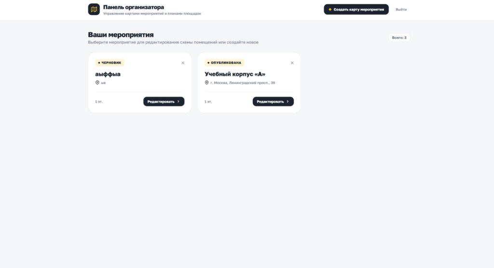
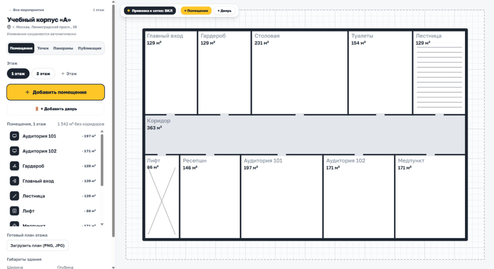
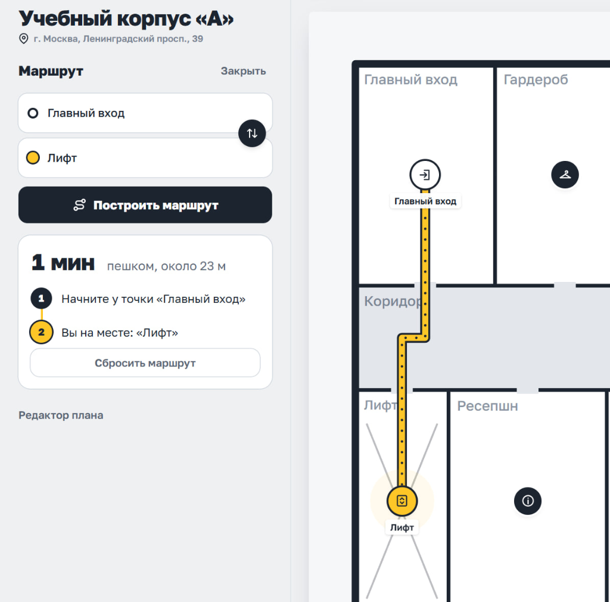
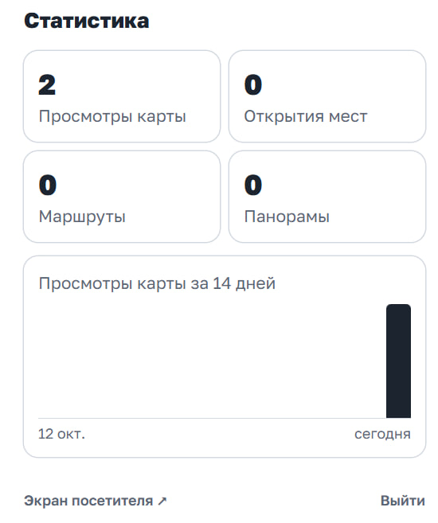

# Интерактивная навигация внутри зданий: «Карта Пространства»

**Презентация функционала и архитектуры решения**

---

## Слайд 1. Главная идея: навигация внутри помещений без барьеров

### Главный тезис
> Посетитель открывает интерактивную карту этажа по QR-коду за 1 секунду прямо в браузере — без установки мобильных приложений и без регистрации.

### В чём проблема сегодня
- **Сложная ориентация**: В больших ТЦ, выставочных залах, университетах и на конференциях люди тратят по 10–20 минут на поиск нужного кабинета, стенда или лифта.
- **Устаревшие схемы**: Статичные бумажные планы или PDF-схемы не показывают, где человек находится сейчас и как дойти до цели шаг за шагом.
- **Барьер установки**: Никто не хочет скачивать отдельное приложение ради одного мероприятия на пару часов.

### Наше решение
1. **Мгновенный старт**: Карта загружается прямо по ссылке или QR-коду на телефоне или компьютере.
2. **Точный маршрут**: Система строит оптимальный путь по коридорам и проходам с указанием времени в пути.
3. **Удобный редактор**: Организатор создает или обновляет схему за 15 минут в простом визуальном конструкторе.

---

## Слайд 2. Панель организатора: управление всеми площадками

### Главный тезис
> Все мероприятия и площадки в одном месте: создание карты в пару кликов, разделение на черновики и готовые публикации.

### Что видит организатор
- **Карточки мероприятий**: Наглядный список всех созданных карт со статусом («Черновик» для работы команды или «Опубликована» для гостей).
- **Привязка к адресам**: К каждому мероприятию привязан точный физический адрес (например, «ул. Ленина, 42», «пр. Мира, 105»).
- **Быстрый доступ к редактированию**: Переход в редактор этажей одной кнопкой.
- **Безопасный вход**: Защита административной панели паролем (`demo123`), исключающая случайные правки гостями.

---

## Слайд 3. Конструктор схемы: просто, как конструктор Lego

### Главный тезис
> Рисование стен и коридоров мышкой без навыков в сложных инженерных программах.

### Ключевые возможности редактора
- **Координатная сетка с магнитной привязкой**: Все стены и узлы автоматически выравниваются с шагом в 1 метр, линии получаются ровными.
- **Любые формы помещений**: Можно создать прямоугольную комнату, задав нужную площадь в м², а затем двигать углы или разбивать стены кнопками «+», создавая помещения сложной формы.
- **Архитектурные двери**: Добавление одностворчатых, двустворчатых дверей и открытых проемов с выбором ширины (от 0.8 до 2.0 м) и поворотом на 90°.
- **Граф навигации**: Скрытая сетка проходов автоматически соединяет входы, лифты и кабинеты для последующего поиска пути.

---

## Слайд 4. Навигация для гостя: маршрут в 1 клик

### Главный тезис
> Гость выбирает начальную и конечную точку — система сразу чертит понятную линию пути и пишет время ходьбы.

### Как это работает для посетителя
- **Окно выбора при входе**: Посетитель выбирает нужное мероприятие из каталога или сразу попадает на нужный этаж по персональному QR-коду.
- **Пошаговое построение пути**: Например, от точки «Главный вход» до «Лифт» (путь: 1 минута пешком).
- **Интерактивные точки интереса**: Кликая на кабинеты, зоны отдыха, кафе или туалеты, гость видит название, описание и кнопку «Маршрут сюда».
- **Масштабирование и панорамирование**: Карта плавно приближается и крутится пальцами на смартфоне или колесом мыши на ПК.

---

## Слайд 5. Аналитика и статистика посещаемости

### Главный тезис
> Организатор точно знает, какие стенды и зоны популярны, а где посетителей мало.

### Реальные цифры в дашборде
- **Счетчик просмотров**: Общее количество открытий карты гостями.
- **Клики по точкам интереса**: Сколько раз нажимали на конкретные стенды, зоны и кабинеты.
- **Построенные маршруты**: Количество обращений к поиску пути.
- **График динамики по дням**: Наглядная диаграмма активности за последние 14 дней для оценки пиковых часов мероприятия.

---

## Слайд 6. Наш технологический стек простыми словами

### Главный тезис
> Современные, надежные и быстрые инструменты с открытым исходным кодом без перегрузки лишними слоями.

| Уровень системы | Технология | Простыми словами: почему это круто |
| :--- | :--- | :--- |
| **Интерфейс (Frontend)** | **React 19 + Vite** | Мгновенная загрузка за доли секунды, плавная анимация и работа без зависаний даже на слабых телефонах. |
| **Отрисовка карты** | **Интерактивный векторный SVG** | Карта не теряет четкости при любом приближении. Вектор весит в 50 раз меньше растровых картинок. |
| **Серверная часть (Backend)** | **Python (FastAPI)** | Быстрый асинхронный сервер. Высокая производительность обработки маршрутов и аналитики. |
| **Хранилище данных (Database)** | **PostgreSQL + резервный SQLite** | Надежное промышленное хранение данных с автоматическим резервным запуском в офлайн-режиме без сбоев. |
| **Инфраструктура** | **Docker** | Сервис разворачивается одной командой на любом сервере или ноутбуке. |

---

## Слайд 7. Итоговая ценность проекта

### Главный тезис
> Экономия сотен часов организаторов и полное отсутствие потерявшихся гостей.

| Для организатора | Для посетителя | Для владельца площадки |
| :--- | :--- | :--- |
| **Запуск за 15 минут**: создание плана без вызова дизайнеров и архитекторов. | **0 секунд на регистрацию**: открыл браузер и сразу видишь путь. | **Понимание потоков**: честная аналитика популярности зон и стендов. |
| **Быстрые правки на ходу**: переставили стол или стенд — карта обновилась у всех за секунду. | **Четкое время в пути**: понятно, успеваешь ли на лекцию или встречу. | **Универсальность**: одна платформа для конференций, офисов и выставок. |
